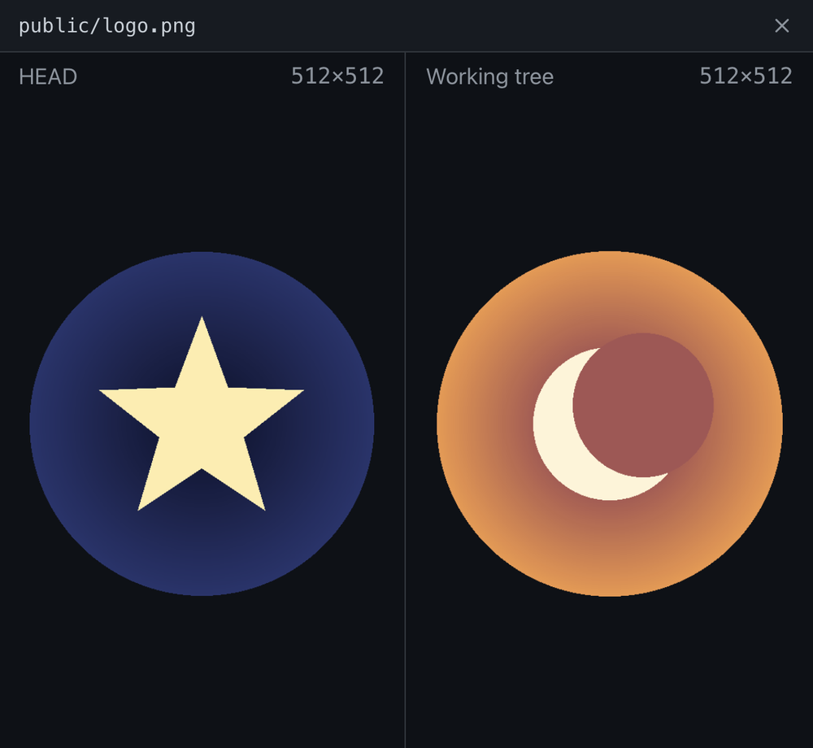
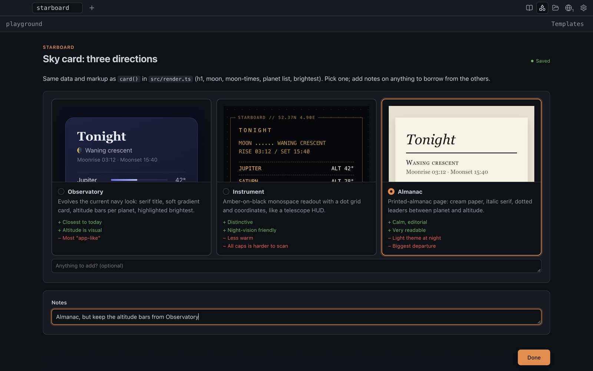

# cuckcode

A macOS-first shell for vibe coding with [Claude Code](https://claude.com/claude-code) or any terminal agent. One window with one tab per project. Each tab has your agents' terminals, a live diff of the working tree against HEAD, a small git panel and a file tree. Playgrounds for pages Claude builds, a folder browser and your own web pages are each a keystroke away. Almost everything is configured in Settings (⌘,), and [plugins](#plugins) add more.

It's deliberately small: Electron, Monaco, xterm and git, with no language servers and nothing running while you type. It runs on macOS today. Linux and Windows are planned (see [Platform support](#platform-support)).

Website: [cuckcode.cc](https://cuckcode.cc). Changes in each release: [CHANGELOG.md](CHANGELOG.md).


What's different from a terminal next to an editor:

- **The diff is live.** Every file Claude touches shows up in the git panel and diffs against HEAD as it's written, images and video included. Typing in the diff edits the file.
- **Claude can show you things.** In a [playground](#playgrounds), Claude builds a page for what's easier to look at than read: design options side by side, a plan to tick off, a form of questions. Your answers go straight back to it.
- **Your edits and Claude's don't collide.** Pressing Enter in a terminal saves your open files first, so Claude always reads what's on screen.
- **One window for every project.** Each project tab keeps its own agents, terminal, diff and git panel. Commit or sync them all at once.

## Platform support

| Platform | Status |
| --- | --- |
| macOS (Apple silicon and Intel) | Supported. Everything in this README. |
| Linux | Planned, not working yet. |
| Windows | Planned, not working yet. |

cuckcode is built on Electron, git and node-pty, which all run on Linux and Windows, but the app itself still assumes macOS in a few places:

- **Terminals** start agents through a POSIX login shell. Windows needs its own way of launching them.
- **Shortcuts** are ⌘-based. A straight swap to Ctrl would collide with terminals (Ctrl+W, Ctrl+K and Ctrl+T already mean something to the shell and to agents), so Linux and Windows need their own shortcut scheme.
- **Paths** are assumed to use `/`, which matters on Windows.
- **The window** uses the macOS title bar and app menu.
- **Installer:** `install.sh` and `npm run app` build a macOS `.app`.
- **Usage meters** read logins from the macOS Keychain.

Linux comes first. If you'd like to help with either port, [open an issue](https://github.com/bananastorycc/cuckcode/issues).

## Requirements

- macOS
- git (`xcode-select --install`)
- Node.js (`brew install node`)
- At least one agent CLI, such as [Claude Code](https://claude.com/claude-code), [Junie](https://www.jetbrains.com/junie/), or any program you run in a terminal

## Install

```
curl -fsSL https://raw.githubusercontent.com/bananastorycc/cuckcode/main/install.sh | bash
```

The installer clones this repo to `~/repos/cuckcode` (set `CUCKCODE_DIR` to put it elsewhere), installs dependencies, builds `/Applications/cuckcode.app` and opens it. You can rerun it safely. After that, launch cuckcode from Spotlight, Launchpad or the Dock.

To install by hand, clone the repo anywhere, then run `npm install && npm run app`.

## How updates work

The installed app is a thin launcher (`boot/index.js`) around your git checkout. On every launch it:

1. pulls the checkout's upstream branch (`main` by default)
2. reinstalls dependencies if the lockfile changed
3. rebuilds if the source changed
4. opens the app

**This means you run whatever is on the branch you track.** To stay on a release, check out its tag (`git -C ~/repos/cuckcode checkout v1.26.2`) or remove the upstream, and the launcher will run what's there. If a build fails, the launcher offers to start the previous build. After an update, a note in the corner shows the new version and what changed.

Rerun `npm run app` only when the Electron version in `package.json` changes. The app tells you when that happens.

Quitting (⌘Q, or closing the window) saves any unsaved edits, kills every terminal, and exits within a few seconds. It doesn't ask anything. Nothing is pulled or pushed on the way out, and nothing keeps running in the background.

## Keybindings

| Key | Action |
| --- | --- |
| ⌘T | Open project, or paste a git remote to clone it |
| ⇧⌘W | Close project (asks first: it kills its terminals) |
| ⌘N | New file, next to the open file (or in the selected folder) |
| ⌘O | Go to file: fuzzy-find any file in the project (↑/↓ + ↩, Esc to cancel) |
| ⌘W | Close the open file |
| ⌘1–9 | Switch project |
| ⇧⌘[ / ⇧⌘] | Previous / next project |
| ⌃⌘← / → / ↑ / ↓ | Move focus to the section on screen in that direction (the focused section has an orange frame) |
| ⇧⌘F | Find in files |
| ⌘S | Save the open file |
| ⌘K | Clear the focused terminal |
| ⌥⌘K | Send the editor's selection to Claude as `@path#L12-20` (no selection: just the file) |
| ⇧↩ | Newline in the claude prompt, without submitting |
| ⌘, | Settings |
| ⌥⌘1–0 | Toggle playground 1–10 |
| ⌃⌘1–0 | Toggle web page 1–10 |
| ⌘E | Toggle README |
| ⌘B | Toggle folders |

Plugins add their own shortcuts, listed under View. Dark mode is in Settings.

**File tree:** ↑/↓ move the cursor and open files as you go, → expands a folder or steps into it, ← collapses it or jumps to its parent, ↩ renames, ⌘⌫ moves to the Trash, right-click for New File / Rename / Move to Trash / Reveal in Finder / Copy Path / Copy Relative Path. Drag a file onto a terminal to paste its path (as an `@` mention in Claude).

**Git file list and history:** ↑/↓ move the selection (and the diff) without touching the mouse; in history, → opens a commit's file list and ← closes it. Right-click a changed file (or ⌘⌫) to discard its changes.

**Branch picker:** click the branch name, type to filter or to name a new one, ↑/↓ + ↩ to switch or create it, Esc to back out.

**Folders:** ← / → step through the lightbox, Space plays/pauses a video, Esc closes it, ⌫ goes up a folder.

## Projects

⌘T lists the folders in your projects folder (the first ⌘T asks where that is) and opens the one you pick as a new tab. Paste a git remote instead and cuckcode clones it there. An empty remote gets a fresh repo: `git init` on `main`, an empty first commit, and a push that sets the upstream, so committing and syncing work from the start.

## Layout

The workspace is made of seven sections: Files, Search, Editor, Terminal, Agents, Git and Scratch. Each is a tab. Drag a tab onto another group to stack them, onto a group's edge to split it, or drag the borders to resize. Whatever you arrange is kept: quitting and reopening brings it back exactly, sizes included.

Settings › Layout switches between layouts:

- **Default**: files over git, search and scratch (tabbed); the editor over a terminal; your agent with the whole right side
- **Classic**: cuckcode's original four columns: files over search; the editor over a terminal; your agent over git and scratch side by side
- **Editor**: the editor in the middle, the other tools tabbed in a narrow column, agent and terminal below
- **Agent**: your agent wide in the middle, the editor and terminal on the right to watch its changes
- **Stacked**: two columns for narrower windows

Under them, type a name to save the current layout. A saved layout stays as you saved it (save again under the same name to replace it), and changes you make after loading one only affect the session.

## Files and diffs

Click any file in the tree to open it — changed files are colored by status (modified / added / deleted / renamed / untracked) and show their diff against HEAD live as Claude edits; unchanged files just open in the editor. **Diff** and **Edit** are both the same underlying model, so typing works in either view, and switching never loses your place. Unchanged regions of a diff collapse to keep big files readable.

Images (`.png` `.jpg` `.gif` `.webp` `.avif` `.svg`) and video (`.mp4` `.mov` `.webm`) get a side-by-side HEAD vs. working-tree viewer instead of a text diff; videos play in sync. A past commit's changes show the same way, parent vs. that commit.




Edits save on ⌘S, when you press Enter in a terminal (so Claude always reads what's on screen and can't be overwritten by it later; an agent prompt that saved anything shows a note listing the files), when you leave the file (open another, close the project), and on quit; there's no save-as-you-type and no prompt. Unsaved files show ●, and are also saved before a commit, a branch switch, or a rename. To undo, discard the change in git.

## Search

⇧⌘F searches the project (respecting `.gitignore`), with case/whole-word/regex toggles and a live-updating replace preview. Replace All (⌘↩ in the replace field) or replace a single file; unsaved edits are saved first so a later save can't clobber the replacement.

## Git

**Commit** stages everything (`git add -A`), commits, and then, if the repo has a remote, syncs straight away: every commit is pushed. **AI** (✨) has Claude write the commit message from the diff, recent commit style, and new files (through a headless `claude -p` on Haiku), then commits the same way. **Sync** runs `pull --rebase --autostash` then push; **Pull**/**Push** run alone.

**Discard Changes** (right-click a file in the list, or ⌘⌫) puts it back as HEAD has it, after a confirm. A new file goes to the Trash instead, with no confirm.

**History** pages through HEAD's log; expand a commit to see its files and open any one's diff against its parent.

The **branch picker** (click the branch name) switches or creates branches, and its Remote section shows where each remote points, edits its URL, or adds `origin` to a repo that has none.

Two buttons above the commit box act on **every open project** at once: ✨ commits each repo with changes, each with its own Claude-written message, and the sync button syncs them all. They're a quick way to leave everything committed and pushed before you walk away.

## Settings

⌘, (or the gear in the header) opens Settings. Every change saves at once.

- **General:** dark mode; the projects folder ⌘T opens from (the first ⌘T asks for it); notifications (on by default); usage meters.
- **Layout:** the presets and your saved layouts (see [Layout](#layout)).
- **Panels:** README and Folders on or off, and the folders Folders lists.
- **Playgrounds**, **Web pages**, **Agents**, **Plugins:** see below.
- **Sync:** your settings, theme and saved layouts as one `cuckcode-config.json`. Export… and Import… move it by hand. Or give it a git repo (use a private one: agent commands and licenses are in the file): cuckcode clones it, pulls at launch, and commits and pushes a few seconds after each change. When you first connect, a repo that already has the file replaces this machine's settings, and an empty one starts from them. When two machines change the same setting, the one that syncs last wins. Installed plugins, open projects and the repo URL itself stay on each machine, and paths under your home folder are written as `~/…`.
- **Reset:** put the layout back to Default, or every setting back to a fresh install's. Open projects, installed plugins and the config repo stay.

## Agents

The Agents section runs agents: real login shells (via `node-pty`) running a program, with a dropdown in its title bar to switch between them. The Terminal section is a separate plain shell in the same folder. List as many agents as you like, in the order you want them. The first one starts with each project, and the rest start the first time you pick them. Each has a name and a type:

- **Claude Code** runs `claude` and tells it about your playgrounds (through `--append-system-prompt`). When Claude finishes or needs your input, that project's tab lights up green and you get a macOS notification (unless you're already looking at it); clicking it brings you back. cuckcode sets this up itself, through Claude Code hooks it passes with `--settings`. macOS asks once whether cuckcode may show notifications, and Settings › General turns them off. ⌥⌘K sends the editor selection to the first Claude agent. With usage meters on, the Agents title bar shows your plan usage and any extra credit spend.
- **Junie** runs `junie --auth-license=<license id>`. Add one per license. With usage meters on, it shows the license's monthly AI credits, the account's top-up credits, and when the monthly ones refill.
- **Command** runs any command line, such as `oterm`.

**About the usage meters:** to show usage, cuckcode reads the login token that Claude Code (or Junie) keeps in the macOS Keychain and calls the same usage endpoint the CLI uses. The token is only sent to that service. cuckcode never writes it to disk, logs it, or refreshes it. macOS may ask once whether cuckcode can read the Keychain item. If you'd rather it didn't, turn the meters off in Settings › General.

When an agent exits you land in a shell in the same folder. The toolbar button (or any key) restarts it.

While a Claude agent is working, cuckcode keeps the Mac from idle-sleeping, so a long task isn't cut off halfway. The display can still sleep, and closing the lid still sleeps. It lets go about 30 seconds after Claude goes quiet.

## Playgrounds

A playground is a page Claude builds for you to look at or fill in, when showing beats describing. Claude is told about your playgrounds when it starts and uses them on its own, without being asked. You say "show me three directions for the sky card"; Claude writes a page into `.cuckcode/playground/<n>/index.html`, and the playground's icon in the header lights up. ⌥⌘<n> shows it over the whole workspace.



You pick, tick, drag or type. Answers save as you go (to `data/answers.json` next to the page), and when you press **Done** the playground closes and Claude is told to read them, so it carries on from your choice:


Pages are built from the playground kit (`src/kit`, served at `media://kit/`): blocks for choices, image and video reviews, forms, plans, triage boards, tables, live design tuning, image annotation, charts, progress and Markdown reports. A page is a few lines naming its blocks, which keeps it cheap for Claude to write, and it follows cuckcode's light or dark theme. The **Templates** button in a playground shows every block live, and [`src/kit/README.md`](src/kit/README.md) documents them. Pages can also be plain HTML, with `window.cuckcode.save/load` to keep answers.


Settings › Playgrounds names them, up to ten per project. With none, Claude isn't told about any.

## README, folders and web pages

**README** (⌘E) shows the project's README, rendered, in place of the editor. It's the project folder's README, or the repo root's when the folder has none, and it updates as the file changes.

**Folders** (⌘B) is a full-window thumbnail browser over the folders you add, for looking through images and video outside of git.

**Web pages** (⌃⌘1–0) each embed a URL full-window: a dev server, a dashboard, any web UI you work alongside. Each is sandboxed so it can't navigate cuckcode itself, and stays loaded in the background once opened. Right-click a page's icon to edit the list.

## Plugins

Plugins are git repos. Open **Plugins…** (in the cuckcode menu, or Settings › Plugins), paste a plugin's git URL and click Install. cuckcode clones it into `~/Library/Application Support/cuckcode/plugins/`. The page lists every plugin with an on/off switch, its commit, whether new commits are waiting (Update pulls them), and its README. Remove moves the clone to the Trash. Add folder… uses a plugin you cloned yourself, for working on one.

Every launch, each plugin with a clean working tree and an upstream is pulled (fast-forward only), and rebuilt (`npm install` when its lockfile changed, then `npm run build`) when its sources are newer than its build. Changes on the Plugins page take effect after a relaunch, which the page offers.

A plugin is code that runs inside cuckcode with your user's full access, and it updates itself from its repo on every launch. Install only plugins whose source you trust.

A plugin is a git repo with a `cuckcode-plugin.json` at its root:

```json
{
  "id": "hello",
  "name": "Hello",
  "main": "dist/main.js",
  "renderer": "dist/renderer.js",
  "style": "dist/style.css",
  "requires": [],
  "commands": [{ "id": "show", "title": "Show Hello", "accelerator": "Cmd+Shift+H" }]
}
```

Every field except `id` and `name` is optional. Each bundle is a single CommonJS file that exports `activate(host)`:

- **main** runs in Electron's main process. It can register functions that the renderer side calls, share an API with other plugins, and get the environment cuckcode's terminals use. It must never block: use async fs and `execFile` only.
- **renderer** runs in the window and gets React and Monaco from cuckcode, so there's only one copy of each. It can add languages and token colors to the editor, keep per-project data that reloads when relevant files change, add a full-window view with a header button and a menu shortcut, and hook into the code editors (for hover previews or ⌘-click go-to-definition).
- **style** is a stylesheet. Use the host's CSS variables (`--bg`, `--fg`, `--accent`, …) so it follows light and dark mode.

If the repo's `package.json` has a `build` script, cuckcode runs it whenever the sources are newer than the bundles. `requires` lists plugin ids that must load first, and a plugin can use the API that each of them provides. The full contract, with what each side gets, is in [`src/shared/plugin.ts`](src/shared/plugin.ts).

cuckcode is GPL-licensed, and plugins run inside it, so a plugin you distribute should use a GPL-compatible license. Plugins you keep to yourself can use any license.

## Scratchpad

One notepad, shared by every project tab, autosaving to app data rather than into any repo — for notes that don't belong in a commit.

## Sessions

Open projects, which tab is active, each project's open file, everything in Settings, and the recently-closed list all survive a quit and come back on the next launch. Which agent each project had in front doesn't: every project reopens on the first agent. With no project open, the welcome screen lists recently closed projects to reopen one or all of them.

Settings live in `~/Library/Application Support/cuckcode/cuckcode-settings.json` and the scratchpad in `cuckcode-scratch.txt` beside it.

## Development

```
npm run dev        # electron-vite with HMR; terminals survive reloads and replay their tail
npm run typecheck
npm test           # vitest
npm run app        # build and reinstall /Applications/cuckcode.app
```

The installed app runs whatever is in its checkout, so a change there takes effect on the next launch. Only `boot/index.js` (the bundle's entry point) and Electron bumps need `npm run app` again.

For UI work, build into a scratch folder and launch Electron on it with `--user-data-dir=<scratch>`, so it gets its own settings file and never touches the one your running cuckcode uses.

## Contributing

Issues and pull requests are welcome. cuckcode stays small on purpose, so open an issue to discuss a new feature before building it. Anything specific to one language, project or workflow belongs in a [plugin](#plugins), not the core.

Ground rules:

- **macOS first.** Changes must keep working on macOS. Code that differs by platform lives in as few places as possible, behind one small module, not as `process.platform` checks scattered through the app.
- **The main process never blocks.** Use async fs (`node:fs/promises`) and async `execFile` only.
- **Watching uses one recursive `fs.watch` per project** (a single FSEvents stream). Git runs with `GIT_OPTIONAL_LOCKS=0`, or `git status` rewrites `.git/index` and wakes the watcher.
- **Monaco is bundled locally** with core and basic languages only: no CDN, no language services, no extra workers. Monaco and xterm are created once and swap models; they're never remounted.
- **Minimal dependencies.** Runtime `dependencies` holds only native modules (`node-pty`). Everything Vite bundles is a devDependency.
- **Latest only.** No migrations or fallbacks for old settings or data formats: when a format changes, old config simply drops.
- **Style:** strict TypeScript, no semicolons, single quotes, 2-space indent, explicit return types on exported functions. Use Tailwind with the CSS-variable color tokens in `src/renderer/src/index.css`, never hardcoded colors. Comments explain why, sparingly.

Run `npm run typecheck && npm test` before sending a change.

### Versioning

`package.json`'s `version` is the only source of truth: the build injects it, and it shows in About cuckcode, on the welcome screen and in the update note. Every change to the app (`src/`, `boot/`, dependencies, build config) bumps it in the same commit and adds a `## X.Y.Z — YYYY-MM-DD` section at the top of [CHANGELOG.md](CHANGELOG.md), in short, user-facing bullets. Docs-only changes don't bump.

- **Major:** every machine has to do something by hand (an Electron bump, a change to `boot/index.js`).
- **Minor:** something you can see or use is new or works differently.
- **Patch:** fixes, polish, refactors.

Releases are tagged `vX.Y.Z`.

## License

Copyright (C) 2026 bananastorycc and cuckcode contributors.

cuckcode is free software: you can redistribute it and/or modify it under the terms of the GNU General Public License as published by the Free Software Foundation, either version 3 of the License, or (at your option) any later version. It is distributed in the hope that it will be useful, but WITHOUT ANY WARRANTY; without even the implied warranty of MERCHANTABILITY or FITNESS FOR A PARTICULAR PURPOSE. See [LICENSE](LICENSE) for the full text.
