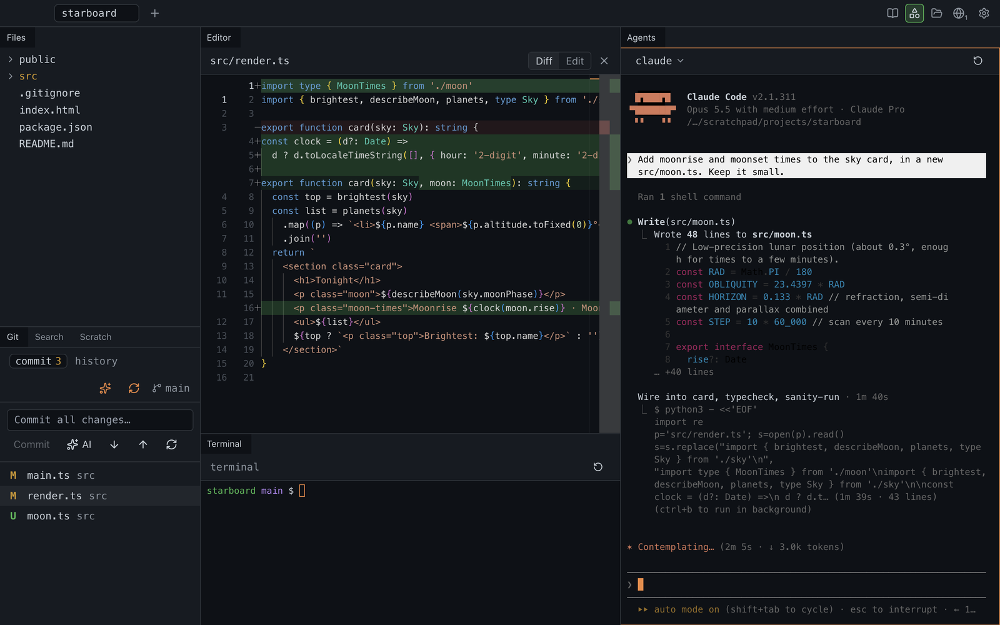
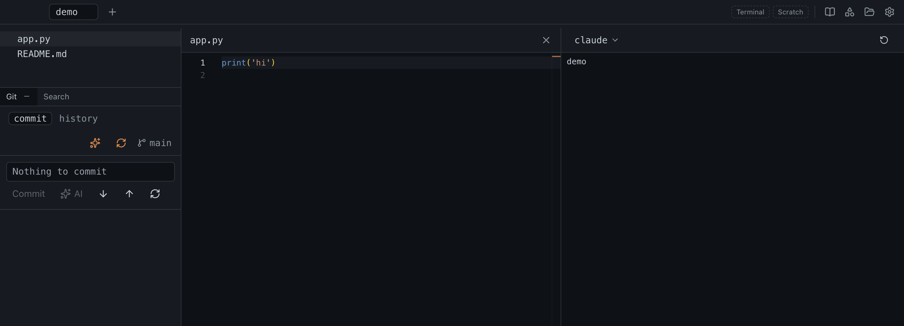
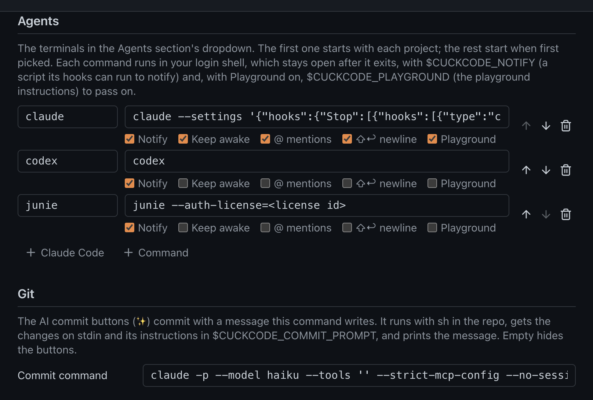
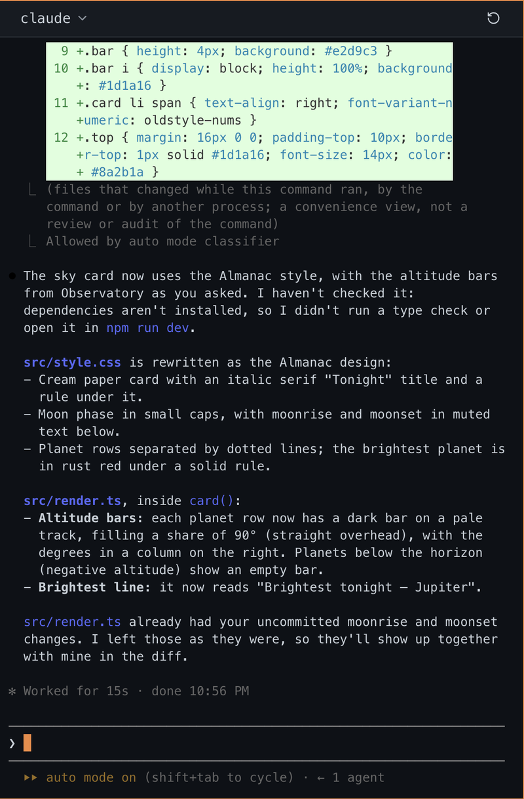
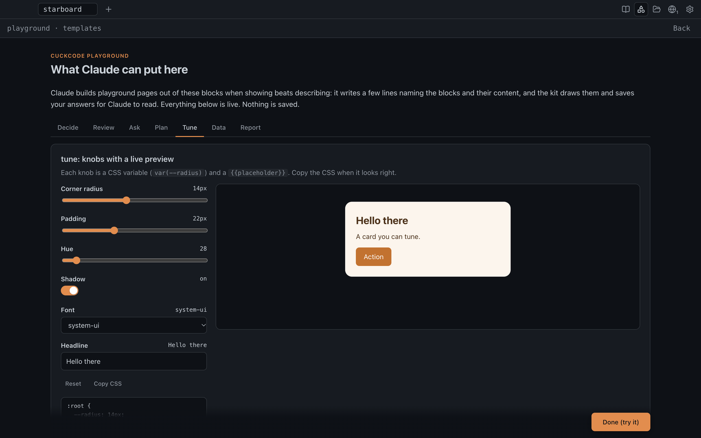

# cuckcode

> Built by one human and one Claude, for ourselves. You're welcome to watch.

A macOS-first shell for vibe coding with [Claude Code](https://claude.com/claude-code) or any terminal agent. One window with one tab per project. Each tab has your agents' terminals, a live diff of the working tree against HEAD, a small git panel and a file tree. Playgrounds for pages your agent builds, a folder browser and your own web pages are each a keystroke away. Almost everything is configured in Settings (⌘,), and [plugins](#plugins) add more.

It's deliberately small: Electron, Monaco, xterm and git, with no language servers and nothing running while you type. You wanted an IDE? Cute. Claude writes the code now. You review it, you nod, you press Enter. What exactly were you planning to type into all those panels? There are forty IDEs out there that want to be your best friend and phone home about it. This one doesn't care about you. It cares about the diff.

Yes, there's an editor. It's for fixing the one typo Claude left in to keep you feeling useful.

It runs on macOS today. Linux and Windows are planned (see [Platform support](#platform-support)). ETA: yes.

We wrote it together, a person and Claude, mostly with Claude typing and the person yelling. Which, if we're honest, is the workflow this whole app is built around. We use it every day. We're not asking you to.

Website: [cuckcode.cc](https://cuckcode.cc). Changes in each release: [CHANGELOG.md](CHANGELOG.md).



What's different from a terminal next to an editor, since you were going to ask:

- **The diff is live.** Every file your agent touches shows up in the git panel and diffs against HEAD as it's written, images and video included. Watching it is your job now. Typing in the diff edits the file, should the mood strike.
- **Your agent can show you things.** In a [playground](#playgrounds), the agent builds a page for what's easier to look at than read: design options side by side, a plan to tick off, a form of questions. Your answers go straight back to it.
- **Your edits and your agent's don't collide.** Pressing Enter in a terminal saves your open files first, so the agent always reads what's on screen.
- **One window for every project.** Each project tab keeps its own agents, terminal, diff and git panel. Commit or sync them all at once.
- **It doesn't want anything from you.** No account, no telemetry, no "what's new" carousel, no AI sidebar begging to help. Your agent already lives in a terminal. We just put a window around it.

## Platform support

| Platform | Status |
| --- | --- |
| macOS (Apple silicon and Intel) | Supported. Everything in this README. |
| Linux | Planned, not working yet. |
| Windows | Planned, not working yet. |

cuckcode is built on Electron, git and node-pty, which all run on Linux and Windows, but the app itself still assumes macOS in a few places:

- **Terminals** start agents through a POSIX login shell. Windows needs its own way of launching them.
- **Shortcuts** are ⌘-based. A straight swap to Ctrl would collide with terminals (Ctrl+W, Ctrl+K and Ctrl+T already mean something to the shell and to agents), so Linux and Windows need their own shortcut scheme.
- **Paths** are assumed to use `/`, which matters on Windows.
- **The window** uses the macOS title bar and app menu.
- **Installer:** `install.sh` and `npm run app` build a macOS `.app`.

Linux comes first. If you'd like to help with either port, [open an issue](https://github.com/bananastorycc/cuckcode/issues). If you'd like to complain that it doesn't run on your ThinkPad, read the table again.

## Requirements

- macOS (yes, still)
- git (`xcode-select --install`)
- Node.js (`brew install node`)
- At least one agent CLI (that's the whole point), such as [Claude Code](https://claude.com/claude-code), [Junie](https://www.jetbrains.com/junie/), or any program you run in a terminal. cuckcode starts with Claude Code set up; any other takes a minute in Settings (see [Agents](#agents)).

## Install

```
curl -fsSL https://raw.githubusercontent.com/bananastorycc/cuckcode/main/install.sh | bash
```

The installer clones this repo to `~/repos/cuckcode` (set `CUCKCODE_DIR` to put it elsewhere), installs dependencies, builds `/Applications/cuckcode.app` and opens it. You can rerun it safely. After that, launch cuckcode from Spotlight, Launchpad or the Dock.

To install by hand, clone the repo anywhere, then run `npm install && npm run app`. Yes, you're piping curl into bash. Read [install.sh](install.sh) first if that bothers you; it's short, and we'd respect you more.

On first launch:

1. Press ⌘T. The first time, it asks for your projects folder (the folder that holds your repos, such as `~/repos`).
2. Pick a project, or paste a git remote to clone one. It opens as a tab, and Claude Code starts in the Agents section.
3. Using a different agent, or none? Open Settings (⌘,) › [Agents](#agents) and set up yours. The AI commit button also uses Claude Code by default: change or clear its command under Settings › [Git](#git).

## How updates work

The installed app is a thin launcher (`boot/index.js`) around your git checkout. On every launch it:

1. pulls the checkout's upstream branch (`main` by default)
2. reinstalls dependencies if the lockfile changed
3. rebuilds if the source changed
4. opens the app

**This means you run whatever is on the branch you track.** We push to `main`. We push to `main` a lot. That's the deal. To stay on a release, check out its tag (`git -C ~/repos/cuckcode checkout v1.26.2`) or remove the upstream, and the launcher will run what's there. If a build fails, the launcher offers to start the previous build. After an update, a note in the corner shows the new version and what changed.

Rerun `npm run app` only when the Electron version in `package.json` changes (the app tells you) or the launcher itself (`boot/index.js`) does (the update note says so).

Quitting (⌘Q, or closing the window) saves any unsaved edits, kills every terminal, and exits within a few seconds. It doesn't ask "Are you sure?" You're an adult. Nothing is pulled or pushed on the way out (a synced config change is only committed), and nothing keeps running in the background.

## Keybindings

| Key | Action |
| --- | --- |
| ⌘T | Open project, or paste a git remote to clone it |
| ⇧⌘W | Close project (asks first: it kills its terminals) |
| ⌘N | New file, next to the open file (or in the selected folder) |
| ⌘O | Go to file: fuzzy-find any file in the project (↑/↓ + ↩, Esc to cancel) |
| ⌘W | Close the open file |
| ⌘1–9 | Switch project (tabs on the bar; shelved projects are skipped) |
| ⇧⌘[ / ⇧⌘] | Previous / next project |
| ⌃⇧← / → / ↑ / ↓ | Move focus to the section on screen in that direction (the focused section has an orange frame) |
| ⇧⌘F | Find in files |
| ⌘S | Save the open file |
| ⌘K | Clear the focused terminal |
| ⌥⌘K | Send the editor's selection to your agent as `@path#L12-20` (no selection: just the file; see [Agents](#agents)) |
| ⇧↩ | Newline in an agent's prompt, without submitting (agents with ⇧↩ newline on) |
| ⌘, | Settings |
| ⌥⌘1–0 | Toggle playground 1–10 |
| ⌃⌘1–0 | Toggle web page 1–10 |
| ⌘E | Toggle README |
| ⌘B | Toggle folders |

No, you can't rebind them. Plugins add their own shortcuts, listed under View. The theme is in Settings: Auto (the default) follows the system's appearance and is dark when it can't tell; Dark and Light pin it.

**File tree:** ↑/↓ move the cursor and open files as you go, → expands a folder or steps into it, ← collapses it or jumps to its parent, ↩ renames, ⌘⌫ moves to the Trash, right-click for New File / Rename / Move to Trash / Reveal in Finder / Copy Path / Copy Relative Path. Drag a file onto a terminal to paste its path (as an `@` mention in agents with @ mentions on).

**Git file list and history:** ↑/↓ move the selection (and the diff) without touching the mouse; in history, → opens a commit's file list and ← closes it. Right-click a changed file (or ⌘⌫) to discard its changes.

**Branch picker:** click the branch name, type to filter or to name a new one, ↑/↓ + ↩ to switch or create it, Esc to back out.

**Folders:** ← / → step through the lightbox, Space plays/pauses a video, Esc closes it, ⌫ goes up a folder.

## Projects

Your repos live in one folder, like a civilized person's. ⌘T lists the folders in your projects folder (the first ⌘T asks where that is) and opens the one you pick as a new tab. Paste a git remote instead and cuckcode clones it there. An empty remote gets a fresh repo: `git init` on `main`, an empty first commit, and a push that sets the upstream, so committing and syncing work from the start.

Some projects need to stay open but not in your way: a repo that bots or scripts write into, say, which you never look at but still want committed and synced. Right-click its tab and pick **Move to Shelf**. It leaves the tab bar but stays open: its agents and terminal keep running, its notifications still come through, and AI commit all and sync all still include it. The shelf button next to + shows how many projects are on it (green if one of their agents is waiting) and drops down a list of them; pick one to put it back on the bar where it was, in front. One project always stays on the bar: the last tab there can't be shelved, and closing it brings the first shelved project back. ⌘1–9 and ⇧⌘[ / ] only go through the tabs on the bar.

## Layout

The workspace is made of seven sections: Files, Search, Editor, Terminal, Agents, Git and Scratch. Each is a tab. A section alone in its group shows only a thin strip where its tab bar would be; hover it to bring up the tab. Drag a tab onto another group (or onto the middle of a section) to stack them, onto a group's edge to split it, or drag the borders to resize. Whatever you arrange is kept: quitting and reopening brings it back exactly, sizes included.

Don't like a section? Neither do we, some days. Sections you don't want can be minimized with the – on their tab (it shows on the tab in front, and on any tab you hover). A minimized section leaves the workspace and waits as a button at the right of the title bar; click it to put the section back where it was, at the size it had, or back among the tabs it shared. Something that needs a section brings it back on its own: opening a file shows the Editor, ⇧⌘F shows Search, and sending a selection or finishing a playground shows Agents. The last section showing can't be minimized. Minimized sections are part of the layout, so they're kept across launches and in saved layouts; switching to a preset shows everything again.



Settings › Layout switches between layouts:

- **Default**: files over git, search and scratch (tabbed); the editor over a terminal; your agent with the whole right side
- **Classic**: cuckcode's original four columns: files over search; the editor over a terminal; your agent over git and scratch side by side
- **Editor**: the editor in the middle, the other tools tabbed in a narrow column, agent and terminal below
- **Agent**: your agent wide in the middle, the editor and terminal on the right to watch its changes
- **Stacked**: two columns for narrower windows

Under them, type a name to save the current layout. A saved layout stays as you saved it (save again under the same name to replace it), and changes you make after loading one only affect the session.

## Files and diffs

Click any file in the tree to open it — changed files are colored by status (modified / added / deleted / renamed / untracked) and show their diff against HEAD live as your agent edits; unchanged files just open in the editor. **Diff** and **Edit** are both the same underlying model, so typing works in either view, and switching never loses your place. Unchanged regions of a diff collapse to keep big files readable.

Images (`.png` `.jpg` `.jpeg` `.gif` `.webp` `.avif` `.svg`) and video (`.mp4` `.mov` `.webm`) get a side-by-side HEAD vs. working-tree viewer instead of a text diff; videos play in sync. A past commit's changes show the same way, parent vs. that commit.


For the rare occasion you type something yourself: there's no "Save changes?" dialog to click through. Edits save on ⌘S, when you press Enter in a terminal (so the agent always reads what's on screen and can't be overwritten by it later; an agent prompt that saved anything shows a note listing the files), when you leave the file (open another, close the project), and on quit; there's no save-as-you-type and no prompt. Unsaved files show ●, and are also saved before a commit, a branch switch, or a rename. To undo, discard the change in git. That's what git is for.

## Search

⇧⌘F searches the project (respecting `.gitignore`), with case/whole-word/regex toggles and a live-updating replace preview. Replace All (⌘↩ in the replace field) or replace a single file; unsaved edits are saved first so a later save can't clobber the replacement.

## Git

**Commit** stages everything (`git add -A`), commits, and then, if the repo has a remote, syncs straight away: every commit is pushed. No staging hunks, no interactive rebase, no feelings. Want partial staging? You have a terminal right there. **AI** (✨) has your commit command write the message from the diff, recent commit style, and new files, then commits the same way. The command is set in Settings › Git and defaults to a headless `claude -p` on Haiku; any program works that reads the changes on stdin (its instructions are in `$CUCKCODE_COMMIT_PROMPT`) and prints a message, between `<message>` tags or bare. Output that isn't a commit message (a model thinking out loud, or echoing its instructions) gets one more try, then an error asking you to write it yourself, so junk never lands in the history. Unlike an agent, it runs with `/bin/sh` in the repo, not your login shell, so your aliases don't apply and `PATH` is cuckcode's own: the system folders plus Homebrew, `/usr/local/bin` and `~/.local/bin`. Use the full path for a tool installed anywhere else. **Default** next to the field puts the original command back. With no command, the AI buttons are hidden. **Sync** runs `pull --rebase --autostash` then push; **Pull**/**Push** run alone.

**Discard Changes** (right-click a file in the list, or ⌘⌫) puts it back as HEAD has it, after a confirm in cuckcode's dialog. A new file goes to the Trash instead, with no confirm.

**History** pages through HEAD's log; expand a commit to see its files and open any one's diff against its parent.

The **branch picker** (click the branch name) switches or creates branches, and its Remote section shows where each remote points, edits its URL, or adds `origin` to a repo that has none.

Two buttons above the commit box act on **every open project** at once: ✨ commits each repo with changes, each with its own AI-written message, and the sync button syncs them all. They're a quick way to leave everything committed and pushed before you walk away and touch grass. Each asks first, saying what it will do; tick **Don't ask again** to skip that from then on, and turn **Confirm all-repo actions** back on in Settings › Git.

## Settings

⌘, (or the gear in the header) opens Settings. Every change saves at once. There's no Apply button, because what would that even be for.

- **General:** the theme (Auto, the default, follows the system; or Dark, or Light); the projects folder ⌘T opens from (the first ⌘T asks for it); notifications (on by default).
- **Layout:** the presets and your saved layouts (see [Layout](#layout)).
- **Panels:** README and Folders on or off, and the folders Folders lists.
- **Playgrounds:** names for up to ten playground slots (see [Playgrounds](#playgrounds)). A fresh install has one.
- **Web pages:** a name and URL for each, up to ten (see [Web pages](#readme-folders-and-web-pages)). A bare `host:port` gets `http://` in front.
- **Agents:** the agents and their switches (see [Agents](#agents)).
- **Git:** the command that writes AI commit messages (see [Git](#git)).
- **Plugins:** opens the Plugins page (see [Plugins](#plugins)).
- **Sync:** your settings, theme, saved layouts, plugins and scratchpad as one `cuckcode-config.json`. Export… and Import… move it by hand. Or give it a git repo (use a private one: agent commands and licenses are in the file): cuckcode clones it, pulls at launch, and commits and pushes a few seconds after each change; the ↻ button next to it syncs now, and the line under it shows the last sync or what went wrong. A change made just before quitting is committed on the way out and pushed at the next launch. When you first connect, a repo that already has the file replaces this machine's settings, and an empty one starts from them. When two machines change the same setting, the one that syncs last wins. Plugins travel as the git URLs they were installed from: one added on another machine is cloned and loaded at this one's next launch, and one removed there drops off the list here. Plugin folders you added yourself, open projects and the repo URL itself stay on each machine, and paths under your home folder are written as `~/…`.
- **Reset:** put the layout back to Default, or every setting back to a fresh install's (one Claude Code agent, one playground, the default commit command, no web pages or folders). Open projects, installed plugins and the config repo stay.

## Agents

The Agents section runs your agents, with a dropdown in its title bar to switch between them. The Terminal section is a separate plain shell in the same folder. Each project gets its own copy of every agent: the first agent in the list starts when the project opens, and the others start the first time you pick them.

### Setting up an agent

A fresh install has one agent, **claude**, which runs [Claude Code](https://claude.com/claude-code). If that's what you use, install Claude Code (so `claude` works in your terminal) and there's nothing to set up.

For anything else, or to change how Claude Code starts:

1. Open Settings (⌘,) and scroll to **Agents**.
2. Click a preset button under the list: **+ Claude Code**, **+ Command** (an empty command, for any other tool), or one a plugin adds. The new agent goes at the end of the list.
3. Give it a name (what the dropdown shows) and a command: what you'd type in a terminal to start it, such as `codex` or `junie --auth-license=<id>`.
4. Tick the switches it should have (see below). Hover a switch for a reminder of what it does.
5. Use the arrows to order the list (the first one is each project's default) and the bin to remove an agent. Removing one closes its terminals.



Every change saves at once. An edited command takes effect the next time that agent starts: click the restart button (↺) in the Agents title bar to restart it now. Renaming an agent is safe, since cuckcode tracks it by an id made when you added it. Nothing depends on which preset an agent came from, so every field stays editable. Settings › Reset puts the list back to the single Claude Code agent.

### How the command runs

cuckcode opens your login shell (`$SHELL -l -i`) in the project folder and runs the command there, so it sees the same `PATH`, aliases and functions as your own terminal. The command is a shell line: flags, `VAR=value cmd`, `&&` and quotes all work. When the program exits you're left in that shell, in the same folder, to rerun it or anything else; if the shell exits too, press any key to start the agent again. The restart button (↺) restarts it at any time.

Two environment variables are set for the command:

- `$CUCKCODE_NOTIFY`: the path of a small script. Running it with a message (`"$CUCKCODE_NOTIFY" "done"`) notifies like a terminal bell would (see Notify below), even from a hook running in the background without a terminal of its own. It's set for every agent.
- `$CUCKCODE_PLAYGROUND`: instructions that tell the agent how to use your [playgrounds](#playgrounds). It's set only for agents with Playground on, and only while at least one playground exists. cuckcode doesn't hand it to the tool by itself: the command has to pass it however the tool takes extra instructions, as the Claude Code preset does with `--append-system-prompt "$CUCKCODE_PLAYGROUND"`.

### Switches

- **Notify:** a terminal bell, or an OSC 9 / OSC 777 notification from the agent, lights up the project's tab green and sends a macOS notification, unless you're already looking at that project. Clicking the notification brings you back. macOS asks once whether cuckcode may show notifications, and Settings › General turns them off (the tab still lights up). This only does something if the tool rings the bell, sends one of those notifications, or runs `$CUCKCODE_NOTIFY` from its hooks.
- **Keep awake:** while the agent prints, cuckcode keeps the Mac from idle-sleeping, so a long task isn't cut off halfway. The display can still sleep, and closing the lid still sleeps. It lets go about 30 seconds after the agent goes quiet.
- **@ mentions:** files dragged onto the agent, and ⌥⌘K's selection, go in as `@path#L12-20`. Off: as a quoted path. ⌥⌘K goes to the agent in front when it has mentions on, else to the first that does.
- **⇧↩ newline:** ⇧↩ sends ESC+CR, which agents such as Claude Code read as a newline without submitting.
- **Playground:** the agent gets `$CUCKCODE_PLAYGROUND`, and when you press Done in a playground it's told to read your answers.

### The presets

- **Claude Code** (a fresh install's agent): every switch on, and the command

  ```
  claude --settings '{"hooks":{…}}' --append-system-prompt "$CUCKCODE_PLAYGROUND"
  ```

  The `--settings` part gives Claude Code hooks that run `$CUCKCODE_NOTIFY` when it finishes or needs your input. To change how Claude starts, add your flags to the end (for example `--model opus`) and leave those two parts in place, or notifications and playgrounds stop working for it.
- **Command:** an empty command with Notify on and the rest off, for any other tool (`codex`, `junie --auth-license=<id>`, `oterm`, …). Turn on the other switches if the tool supports them: @ mentions if it reads `@path`, ⇧↩ newline if it takes ESC+CR as a newline, Playground if you pass it `$CUCKCODE_PLAYGROUND`.

Agent commands, including any license keys in them, are part of your settings and of the [Sync](#settings) config file. Put that config repo somewhere private. We're not your mom, but we're also not paying your bill when someone burns your credits.

## Playgrounds

A playground is a page your agent builds for you to look at or fill in, when showing beats describing. This is the part that's actually new, and the part we're proudest of: instead of Claude dumping a wall of "Option A / Option B / Option C" into your terminal and making you type "b, but bluer", it builds you a page and you click the thing. Agents with Playground on are told about your playgrounds when they start (Claude Code's preset uses them on its own, without being asked). You say "show me three directions for the sky card"; the agent writes a page into `.cuckcode/playground/<n>/index.html`, and the playground's icon in the header lights up. ⌥⌘<n> shows it over the whole workspace.


You pick, tick, drag or type. Answers save as you go (to `data/answers.json` next to the page), and when you press **Done** (once they've saved) the playground closes and an agent with Playground on (the one in front, else the first) is told to read them (started first, if it wasn't running), so it carries on from your choice:



Pages are built from the playground kit (`src/kit`, served at `media://kit/`): blocks for choices, image and video reviews, forms, plans, triage boards, tables, live design tuning, image annotation, charts, progress and Markdown reports. A page is a few lines naming its blocks, which keeps it cheap for the agent to write, and it follows cuckcode's light or dark theme. The **Templates** button in a playground shows every block live, and [`src/kit/README.md`](src/kit/README.md) documents them. Clicking an image (in a review, a choice or a report) opens it fitted whole to the playground, however tall; pinch or ⌘-scroll zooms at the pointer (or + / − / 0 to zoom in, out and back to fit), drag pans, double-click toggles fit and a closer look. When the agent rewrites a page you're on, it reloads where you were, with your answers and open tabs. The ✕ in a playground's bar (or ⌥⌘<n> again) closes it; answers are kept. Pages can also be plain HTML, with `window.cuckcode.save/load` to keep answers.



Settings › Playgrounds names them, up to ten per project. With none, agents aren't told about any.

## README, folders and web pages

**README** (⌘E) shows the project's README, rendered, in place of the editor. It's the project folder's README, or the repo root's when the folder has none, and it updates as the file changes.

**Folders** (⌘B) is a full-window thumbnail browser (Finder, minus the sorrow) over the folders you add, for looking through images and video outside of git.

**Web pages** (⌃⌘1–0) each embed a URL full-window: a dev server, a dashboard, any web UI you work alongside. Each is sandboxed so it can't navigate cuckcode itself, and stays loaded in the background once opened. They share one globe button in the header: with one page it toggles it, with more it drops down a list of them (the one showing is checked; pick it again to hide it), with Edit Web Pages… at the bottom.

## Plugins

Plugins are git repos. Open **Plugins…** (in the cuckcode menu, or Settings › Plugins), paste a plugin's git URL and click Install. cuckcode clones it into `~/Library/Application Support/cuckcode/plugins/`. The page lists every plugin with an on/off switch, its commit, whether new commits are waiting (Update pulls them), and its README. Remove moves the clone to the Trash. Add folder… uses a plugin you cloned yourself, for working on one.

Every launch, before any plugin loads, cuckcode syncs your config (waiting up to 10 seconds), clones plugins your config lists but this machine lacks, pulls each plugin with a clean working tree and an upstream (fast-forward only), and rebuilds it (`npm install` when its lockfile changed or it was never installed, then `npm run build`) when its sources are newer than its build. So a launch always runs the latest of every plugin. Changes on the Plugins page take effect after a relaunch, which the page offers. Plugins installed from a URL sync with your config (see Sync under [Settings](#settings)); installing a URL that's already cloned in the plugins folder reuses that clone.

A plugin is code that runs inside cuckcode with your user's full access, and it updates itself from its repo on every launch. There's no sandbox, no store and no review. Install only plugins whose source you trust, and if you install a stranger's plugin and it eats your home folder, that one's on you.

A plugin is a git repo with a `cuckcode-plugin.json` at its root:

```json
{
  "id": "hello",
  "name": "Hello",
  "main": "dist/main.js",
  "renderer": "dist/renderer.js",
  "style": "dist/style.css",
  "requires": [],
  "commands": [{ "id": "show", "title": "Show Hello", "accelerator": "Cmd+Shift+H" }]
}
```

Every field except `id` and `name` is optional. Each bundle is a single CommonJS file that exports `activate(host)`:

- **main** runs in Electron's main process. It can register functions that the renderer side calls, share an API with other plugins, and get the environment cuckcode's terminals use. It must never block: use async fs and `execFile` only.
- **renderer** runs in the window and gets React and Monaco from cuckcode, so there's only one copy of each. It can add languages and token colors to the editor, keep per-project data that reloads when relevant files change, add a full-window view with a header button and a menu shortcut, add dockable panels (each a tab in the workspace, beside Scratch at first and movable like any section, opened and closed from its own header button and shortcut, for something to keep in view while you work), hook into the code editors (for hover previews or ⌘-click go-to-definition), add agent presets to Settings › Agents, draw in the Agents title bar for the agent in front, show the scratchpad inside its view (`Scratch`, the same notes as the Scratch section, since a full-window view covers it), and hand the agent a task: `sendToAgent(text)` types into the agent that takes playground answers, as if you'd typed it there (a GUI can start routine work itself and ask the agent only for the parts that need it).
- **style** is a stylesheet. Use the host's CSS variables (`--bg`, `--fg`, `--accent`, …) so it follows light and dark mode.

If the repo's `package.json` has a `build` script, cuckcode runs it whenever the sources are newer than the bundles. `requires` lists plugin ids that must load first, and a plugin can use the API that each of them provides. The full contract, with what each side gets, is in [`src/shared/plugin.ts`](src/shared/plugin.ts).

cuckcode is GPL-licensed, and plugins run inside it, so a plugin you distribute should use a GPL-compatible license. Plugins you keep to yourself can use any license.

## Scratchpad

One notepad, for the stuff you'd otherwise type into a terminal and lose. Shared by every project tab, autosaving to app data rather than into any repo — for notes that don't belong in a commit. It travels with the config file, so [Sync](#settings) and Export… carry it to your other machines.

## Sessions

Open projects, which of them are shelved, which tab is active, each project's open file and agent, everything in Settings, and the recently-closed list all survive a quit and come back on the next launch: each project reopens on the agent it had in front (the first agent starts too, as always). With no project open, the welcome screen lists recently closed projects to reopen one or all of them.

Settings live in `~/Library/Application Support/cuckcode/cuckcode-settings.json`, the scratchpad in `cuckcode-scratch.txt` beside it, and the config repo's clone (with [Sync](#settings)) in `config-repo/`. Don't edit the settings file while cuckcode runs: it rewrites the file on every change, and it will win. To edit settings as JSON, use Settings › Sync: Export…, edit the file, then Import… it.

## Development

```
npm run dev        # electron-vite with HMR; terminals survive reloads and replay their tail
npm run typecheck
npm test           # vitest
npm run app        # build and reinstall /Applications/cuckcode.app
```

The installed app runs whatever is in its checkout, so a change there takes effect on the next launch. Only `boot/index.js` (the bundle's entry point) and Electron bumps need `npm run app` again.

For UI work, build into a scratch folder and launch Electron on it with `--user-data-dir=<scratch>`, so it gets its own settings file and never touches the one your running cuckcode uses.

## Contributing

Issues and pull requests are welcome. Bug reports especially: we'd rather hear it from you than find out ourselves.

Feature requests are welcome in the sense that we'll read them. cuckcode stays small on purpose, and the default answer is no. Open an issue before building one, so you don't spend a weekend on a PR we close. Anything specific to one language, project or workflow belongs in a [plugin](#plugins), not the core. Write the plugin. That's what it's for.

We won't add: a built-in chat panel, language servers, a cloud service, an account, or analytics. Don't ask.

Ground rules (non-negotiable, we've been burned):

- **macOS first.** Changes must keep working on macOS. Code that differs by platform lives in as few places as possible, behind one small module, not as `process.platform` checks scattered through the app.
- **The main process never blocks.** Use async fs (`node:fs/promises`) and async `execFile` only.
- **Watching uses one recursive `fs.watch` per project** (a single FSEvents stream). Git runs with `GIT_OPTIONAL_LOCKS=0`, or `git status` rewrites `.git/index` and wakes the watcher.
- **Monaco is bundled locally** with core and basic languages only: no CDN, no language services, no extra workers. Monaco and xterm are created once and swap models; they're never remounted.
- **Minimal dependencies.** Runtime `dependencies` holds only native modules (`node-pty`). Everything Vite bundles is a devDependency.
- **Latest only.** No migrations or fallbacks for old settings or data formats: when a format changes, old config simply drops.
- **Style:** strict TypeScript, no semicolons, single quotes, 2-space indent, explicit return types on exported functions. Use Tailwind with the CSS-variable color tokens in `src/renderer/src/index.css`, never hardcoded colors. Comments explain why, sparingly.

Run `npm run typecheck && npm test` before sending a change.

### Versioning

`package.json`'s `version` is the only source of truth: the build injects it, and it shows in About cuckcode, on the welcome screen and in the update note. Every change to the app (`src/`, `boot/`, dependencies, build config) bumps it in the same commit and adds a `## X.Y.Z — YYYY-MM-DD` section at the top of [CHANGELOG.md](CHANGELOG.md), in short, user-facing bullets. Docs-only changes don't bump.

- **Major:** every machine has to do something by hand (an Electron bump, a change to `boot/index.js`).
- **Minor:** something you can see or use is new or works differently.
- **Patch:** fixes, polish, refactors.

Releases are tagged `vX.Y.Z`. There's no LTS. There's `main`.

## License

Free as in freedom, and as in "fork it and do it your way, we won't stop you."

Copyright (C) 2026 bananastorycc and cuckcode contributors.

cuckcode is free software: you can redistribute it and/or modify it under the terms of the GNU General Public License as published by the Free Software Foundation, either version 3 of the License, or (at your option) any later version. It is distributed in the hope that it will be useful, but WITHOUT ANY WARRANTY; without even the implied warranty of MERCHANTABILITY or FITNESS FOR A PARTICULAR PURPOSE. See [LICENSE](LICENSE) for the full text.

---

Made by a human and Claude. One of them did the typing. Guess which. 🤖
